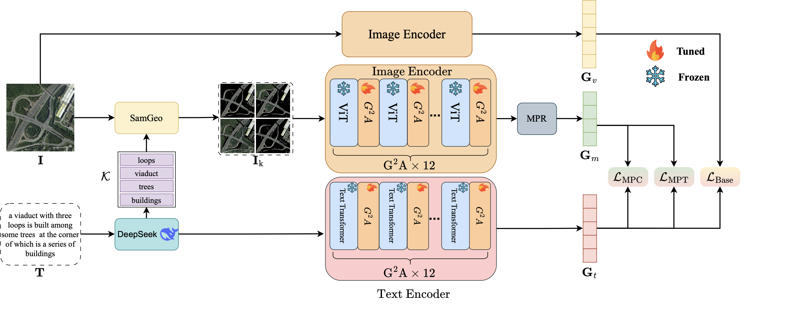
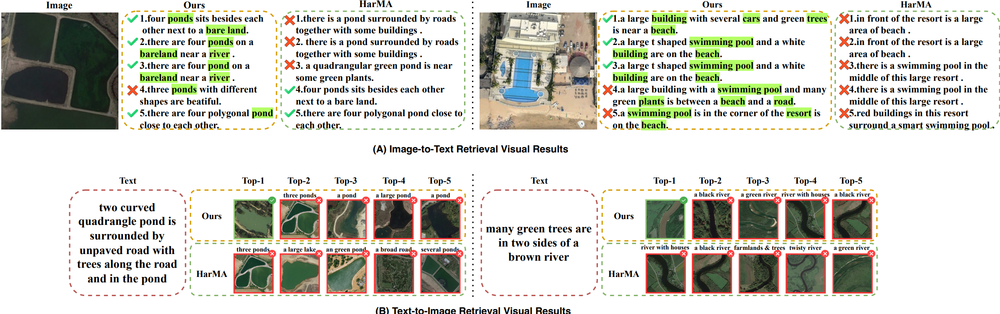
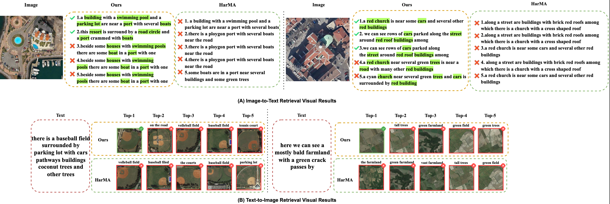
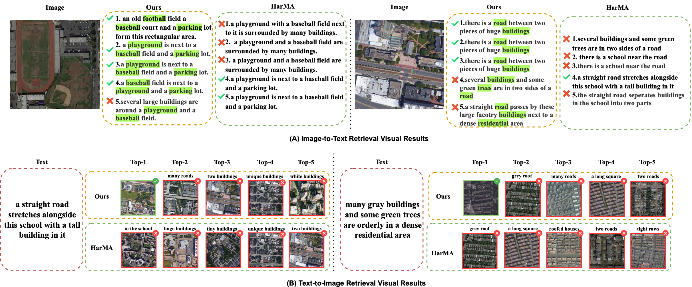
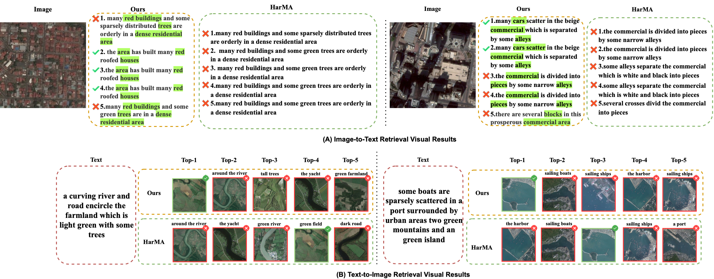

<div align="center">

# [ICME2026] MPS-CLIP
**Multi-Perspective Subimage CLIP with Keyword Guidance for Remote Sensing Image-Text Retrieval**

[](https://arxiv.org/abs/2601.18190)
[](https://lcrucial1f.com/MPS-CLIP/)
[](https://huggingface.co/datasets/lcrucial1f/MPS-CLIP_Data/tree/main)
[](https://huggingface.co/lcrucial1f/MPS-CLIP-Models)

<p align="center">
  <a href="#-news">News</a> •
  <a href="#-overview">Overview</a> •
  <a href="#%EF%B8%8F-visualization">Results</a> •
  <a href="#%EF%B8%8F-installation">Installation</a> •
  <a href="#%EF%B8%8F-code-structure">Code</a> •
  <a href="#-data-preparation">Data</a> •
  <a href="#-training">Training</a> •
  <a href="#-testing--evaluation">Testing</a>
</p>

</div>

---

## 💥 News

- **[2026-11-09]** Released the trained checkpoints for RSICD and RSITMD on [🤗 HuggingFace](https://huggingface.co/lcrucial1f/MPS-CLIP-Models).
- **[2026-11-08]** Released the keyword-guided subimages for RSICD and RSITMD on [🤗 HuggingFace](https://huggingface.co/datasets/lcrucial1f/MPS-CLIP_Data).
- **[2026-03-27]** MPS-CLIP is accepted to ICME 2026.

---

## 📖 Overview

**MPS-CLIP** introduces a novel approach for Remote Sensing Image-Text Retrieval (RSITR) by leveraging multi-perspective subimages and keyword guidance to enhance feature alignment.

### The Pipeline
<div align="center">
  
</div>

---

## 🖼️ Visualization

Qualitative retrieval results on RSITMD and RSICD datasets.

<div align="center">
  
| **Retrieval Example 2** | **Retrieval Example 2** |
|:---:|:---:|
|  |  |

| **Retrieval Example 3** | **Retrieval Example 4** |
|:---:|:---:|
|  |  |

</div>

---

## 🛠️ Installation

Install dependencies:

```bash
pip install -r requirements.txt
```

The repository includes the MPS-CLIP retrieval model and its customized
`open_clip` implementation. No source files need to be copied from another
project.

---

## 🗂️ Code Structure

```text
MPS-CLIP/
├── run.py                        # Launcher: picks the config of a --task and starts Retrieval.py with torch.distributed
├── Retrieval.py                  # Training / evaluation loop, recall metrics, checkpoint saving
├── configs/
│   ├── Retrieval_rsicd_vit.yaml  # RSICD, OpenCLIP ViT-B/32 (LAION-2B) backbone
│   ├── Retrieval_rsitmd_vit.yaml # RSITMD, OpenCLIP ViT-B/32 (LAION-2B) backbone
│   └── Retrieval_*_geo.yaml      # GeoRSCLIP backbone variants (not used for the released checkpoints)
├── models/
│   ├── model_retrieval.py        # MPSCLIP: CLIP backbone + subimage branch, forward pass and losses
│   ├── mpsclip.py                # Contrastive and weighted triplet losses, multi-perspective losses
│   └── mpr.py                    # Multi-Perspective Representation (MPR) head
├── open_clip/                    # OpenCLIP with the MPS-CLIP adapters
│   ├── model.py                  # CLIP towers and the G2A adapter (G2Adapter)
│   ├── transformer.py            # Transformer blocks; the G2A adapter is applied to each block's MLP output
│   ├── GA.py                     # Gated global attention used inside the text-tower adapter
│   └── ...                       # Tokenizer, transforms, pretrained-weight loading (from OpenCLIP)
├── dataset/
│   ├── __init__.py               # create_dataset / create_loader, padding of a variable number of subimages
│   └── re_dataset.py             # Loads an image, its caption(s) and its keyword-guided subimages
├── images_segmentation/          # Subimage generation (see "Generate Subimages")
│   ├── extracting_keywords.py    # Extracts the nouns of each caption with DeepSeek
│   ├── segmentation.py           # Segments one <noun>_blackbg.png per (image, noun) with LangSAM
│   └── launcher.py               # Runs segmentation.py on several GPUs
├── data/finetune/                # Annotations; *_train1.json / *_test1.json add the extracted nouns
├── optim.py, scheduler.py        # AdamW parameter groups and the linear warmup schedule
├── utils/                        # Distributed helpers and metric logging
└── tests/                        # Unit tests for the losses and the MPR head
```

---

## 📂 Data Preparation

We use RSITMD and RSICD datasets for all experiments.

**Download Data:**
Download the images and the keyword-guided subimages from
[HuggingFace 🤗](https://huggingface.co/datasets/lcrucial1f/MPS-CLIP_Data) and
extract them into `data/`:

```bash
hf download lcrucial1f/MPS-CLIP_Data --repo-type dataset --local-dir data/
cd data
unzip rsicd.zip                       # -> rsicd/{train,val,test}
unzip rsitmd.zip                      # -> rsitmd/{train,val,test}
unzip rsicd_subimage.zip -d rsicd     # -> rsicd/{train_sub1,test_sub1}
unzip rsitmd_subimage.zip -d rsitmd   # -> rsitmd/{train_sub1,test_sub1}
```

The annotations are in `data/finetune`. The `*_train1.json` and
`*_test1.json` files add the extracted nouns and are used by the default
configs.

**Configure Paths:**
The default configs use the layout above. If you place the data elsewhere,
update the four root fields in the corresponding YAML file:

```yaml
image_root: 'data/rsicd'
train_sub_root: 'data/rsicd/train_sub1'
val_sub_root: 'data/rsicd/test_sub1'
test_sub_root: 'data/rsicd/test_sub1'
```

Each subimage directory follows this layout:

```text
train_sub1/<image_stem>/<noun>_blackbg.png
```

**Generate Subimages (optional):**
The released subimages were made with the scripts in `images_segmentation/`.
You only need to run them to rebuild the subimages or to process a new dataset.

1. Extract the nouns of each caption with an LLM (DeepSeek):

   ```bash
   export DEEPSEEK_API_KEY=<your key>
   python images_segmentation/extracting_keywords.py \
       --input data/finetune/rsicd_train.json \
       --output data/finetune/rsicd_train1.json
   ```

   LLM output is not deterministic, so a re-run gives slightly different nouns
   than the released `*1.json` files.

2. Segment one black-background subimage per (image, noun) with LangSAM from
   [segment-geospatial](https://github.com/opengeos/segment-geospatial)
   (GroundingDINO + SAM):

   ```bash
   python images_segmentation/launcher.py --gpus 0,1,2,3 \
       --json_path data/finetune/rsicd_train1.json \
       --image_root data/rsicd \
       --out_root data/rsicd/train_sub1
   ```

   `launcher.py` starts one `segmentation.py` process per GPU. Run
   `segmentation.py` with the same arguments, without `--gpus`, to use a
   single GPU. Use `*_test1.json` and `test_sub1` for the test split.

Segmentation needs `pip install segment-geospatial groundingdino-py`, best in
a separate environment: transformers 4.x does not import with
huggingface-hub 1.x. The SAM ViT-H and GroundingDINO Swin-B weights are
downloaded on the first run.

---

## 🚀 Training

**1. Download Pretrained Weights (GeoRSCLIP tasks only)**

* Download: `RS5M_ViT-B-32_RET-2.pt`
* Place in: `models/pretrain/`

The `*_vit` tasks start from the OpenCLIP ViT-B/32 LAION-2B weights
(`laion2b_s34b_b79k`, downloaded from HuggingFace on first use; set
`pretrained` in the YAML to a local `open_clip_pytorch_model.bin` for offline
machines). The `*_geo` tasks load the GeoRSCLIP checkpoint configured by
`pretrained_path`.

**2. Start Training**

`--dist fN` launches N processes on the GPUs visible through
`CUDA_VISIBLE_DEVICES`.

RSITMD Dataset (2 GPUs × 128 images per step, with gradient checkpointing):

```bash
CUDA_VISIBLE_DEVICES=0,1 python run.py \
  --task 'itr_rsitmd_vit' \
  --dist "f2" \
  --output_dir './checkpoints/MPS-CLIP/full_rsitmd_vit'
```

RSICD Dataset (2 GPUs × 64 images per step):

```bash
CUDA_VISIBLE_DEVICES=0,1 python run.py \
  --task 'itr_rsicd_vit' \
  --dist "f2" \
  --output_dir './checkpoints/MPS-CLIP/full_rsicd_vit'
```

---

## ⚡ Testing / Evaluation

**Checkpoints:** the trained models are on
[🤗 HuggingFace](https://huggingface.co/lcrucial1f/MPS-CLIP-Models):

| Dataset | Checkpoint | mR |
|:---:|:---|:---:|
| RSICD | `MPS-CLIP_ViT-B-32_RSICD_rmean35.24.pth` | 35.24 |
| RSITMD | `MPS-CLIP_ViT-B-32_RSITMD_rmean48.86.pth` | 48.86 |

```python
from huggingface_hub import hf_hub_download

for name in ["MPS-CLIP_ViT-B-32_RSICD_rmean35.24.pth", "MPS-CLIP_ViT-B-32_RSITMD_rmean48.86.pth"]:
    hf_hub_download("lcrucial1f/MPS-CLIP-Models", name, local_dir="./checkpoints/MPS-CLIP")
```

Pass `--evaluate`; the launcher sets evaluation mode in the loaded config.
To evaluate a model you trained, pass its `checkpoint_best.pth` instead.

Evaluate on RSITMD:

```bash
python run.py \
  --task 'itr_rsitmd_vit' \
  --dist "gpu0" \
  --output_dir './checkpoints/MPS-CLIP/test' \
  --checkpoint './checkpoints/MPS-CLIP/MPS-CLIP_ViT-B-32_RSITMD_rmean48.86.pth' \
  --evaluate
```

Evaluate on RSICD:

```bash
python run.py \
  --task 'itr_rsicd_vit' \
  --dist "gpu0" \
  --output_dir './checkpoints/MPS-CLIP/test' \
  --checkpoint './checkpoints/MPS-CLIP/MPS-CLIP_ViT-B-32_RSICD_rmean35.24.pth' \
  --evaluate
```

---

## 🙏 Acknowledgement

This code is forked from [HarMA](https://github.com/seekerhuang/HarMA). We thank
the authors for releasing their code.

---

## 🖊️ Citation

If you find this work useful for your research, please consider citing our paper:

```bibtex
@article{li2026mpsclip,
  title={Multi-Perspective Subimage CLIP with Keyword Guidance for Remote Sensing Image-Text Retrieval},
  author={Li, Yifan and Wang, Shiying and Huang, Jianqiang},
  journal={arXiv preprint arXiv:2601.18190},
  year={2026}
}
```
